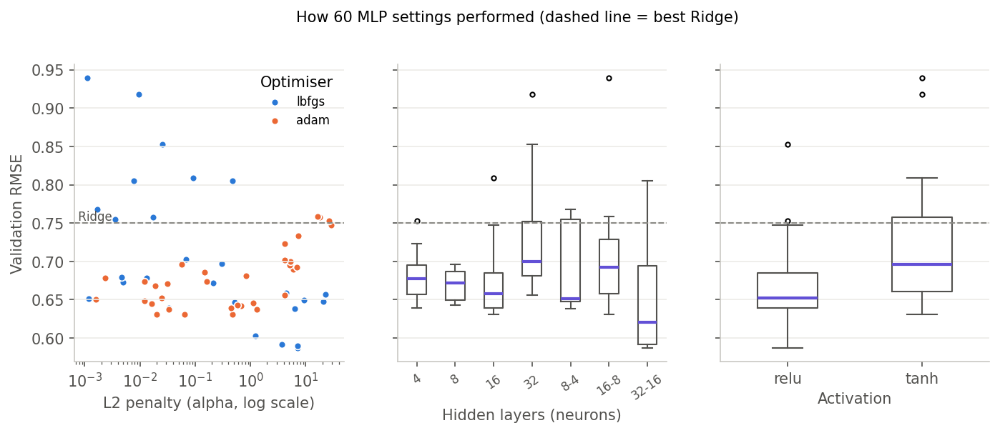
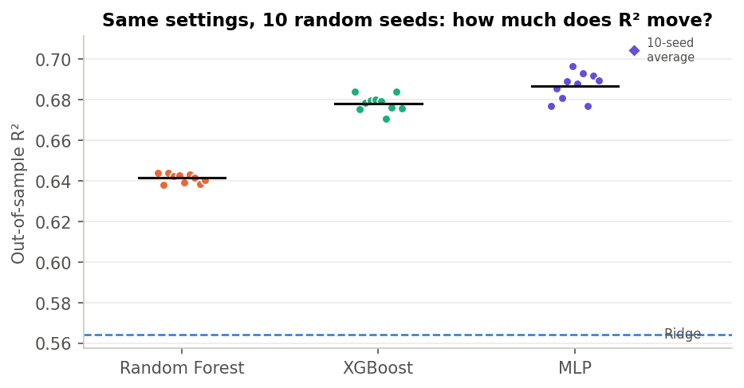
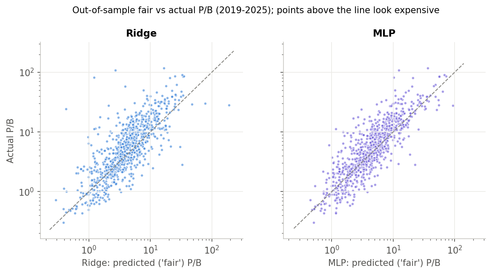
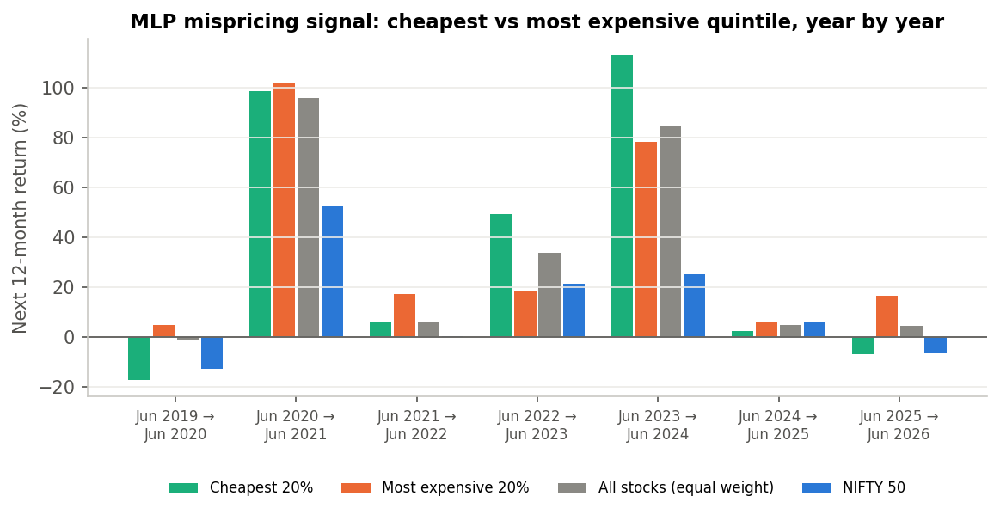

# What does the market pay for? A neural-network fair-value model for Indian large caps

Advanced Machine Learning (AMLBT) term project, Goa Institute of Management, Big Data Analytics.
Sanket Gore, Milind Gauns and Shakthi Keshavan.

[](https://colab.research.google.com/github/SanketGore/AMLBT_Project/blob/main/Fair_Value_NN_Prowess.ipynb)
&nbsp; Paper: [`paper/main.pdf`](paper/main.pdf) &nbsp;|&nbsp; Notebook with all outputs: [`Fair_Value_NN_Prowess.ipynb`](Fair_Value_NN_Prowess.ipynb)

We train a neural network to predict a company's price-to-book ratio (P/B) from its accounts and recent price behaviour, compare it with Ridge regression, Random Forest, XGBoost and a naive benchmark, and then ask whether the gap between actual and "fair" P/B predicts the next year's return. The sample is 1,102 company-years from 141 non-financial NIFTY 200 companies, with formation dates every 30 June from 2017 to 2025. All tuning uses past years only, and every result is fixed by seeds and single-threaded maths, so a rerun on the same data gives the same numbers to the last digit.

## Key findings

| Walk-forward test, 2019–2025 (879 predictions) | Out-of-sample R² | RMSE (log P/B) | Rank correlation |
|---|---:|---:|---:|
| Ridge regression | 0.564 | 0.696 | 0.787 |
| Random Forest | 0.641 | 0.632 | 0.826 |
| XGBoost | 0.683 | 0.594 | 0.843 |
| **MLP (tuned neural network)** | **0.701** | **0.577** | **0.842** |
| MLP, average of 10 seeds | 0.705 | | |
| Naive: last year's own P/B | 0.812 | 0.455 | 0.931 |

1. **No model beats last year's own P/B** (R² 0.812, scored on the 860 rows that have a previous year). Valuations are persistent, and much of a stock's multiple reflects things the accounts do not capture. Among the fundamentals models, the MLP (0.701 in the reported run, 0.687 averaged over seeds) and XGBoost (0.683) are level within seed noise; both are well ahead of Ridge (0.564). The MLP also had the largest tuning budget (30 settings per step against 4–8 for the tree models).
2. **Tuning matters as much as the choice of algorithm.** Across 60 random settings, validation RMSE ranged from 0.587 to 0.940, against 0.750 for the best Ridge model, and the median setting (0.673) was well short of the best. The winner was two hidden layers (32-16), ReLU, the L-BFGS optimiser and a strong L2 penalty (alpha = 7.08). Architecture moved the error most, followed by activation; the optimiser on its own barely mattered.

   

3. **The network is stable across random seeds.** With the hyperparameters fixed, ten seeds gave R² between 0.677 and 0.697, and averaging the ten networks lifted R² to 0.705.

   

4. **Fundamentals carry the signal.** With accounting inputs alone the MLP reaches R² = 0.630 (XGBoost 0.643); with market inputs alone (momentum, volatility, beta) it reaches only 0.053. The single-group runs used 15 MLP settings per step against 30 for the combined run, so part of the combined model's gain may come from tuning.
5. **For companies the model has never seen, XGBoost generalises better** (R² 0.610 against 0.577 for the MLP and 0.560 for Ridge, five-fold leave-company-out). This is the realistic accuracy for valuing an unlisted business (a typical error of about 1.9 times P/B), and it is optimistic, because hyperparameters were tuned on the full sample.

   

6. **Mispricing does not predict returns.** Sorting stocks each June by how far they trade below the MLP's fair value, the cheapest fifth returned 35.1% a year on average and the most expensive fifth 34.7%. The mean rank correlation (IC) was −0.06 (t = −0.86). Seven yearly observations cannot rule out a small effect. A fair-value model is useful for explaining and benchmarking valuations, not as a stock-picking rule.

   

## Repository layout

```
AMLBT_Project/
├── Fair_Value_NN_Prowess.ipynb   main study, saved with the output cells of the reported run
├── requirements.txt              library versions of that run (Google Colab, Python 3.13)
├── data/
│   ├── README.md                 full description of the Prowess data and how to rebuild it
│   ├── universe.csv              the 147 companies: NSE symbol, ISIN, industry, sector, years used
│   └── prowess_raw/
│       └── MANIFEST.csv          SHA-256 checksums of the nine Prowess files (files not included)
├── outputs/
│   ├── summary.json              headline results in machine-readable form
│   ├── fingerprint.txt           hash of the key result tables (cc76887f...)
│   ├── environment.json          exact library versions
│   ├── tables/                   every table in the paper as CSV
│   └── figures/                  fig1 to fig8 as PNG
├── paper/                        IEEE conference paper: main.tex, main.pdf, figures, IEEEtran.cls
└── pilot_screener/               earlier 20-company pilot on Screener.in data (notebook, outputs, checksums)
```

**Data licence.** The inputs come from CMIE ProwessIQ under GIM's institutional licence, which does not allow redistribution, so the raw files and the company-level tables built from them are not in this repository. [`data/README.md`](data/README.md) describes every file, field, unit, date convention and filter, gives the exact text layout the notebook reads, and maps each field to a public source. Anyone with Prowess access can download identical files and check them against the checksums; anyone without it can rebuild comparable inputs from public filings and exchange prices.

## Running the notebook

1. Put the nine data files in `data/prowess_raw/` (see [`data/README.md`](data/README.md)).
2. Install the libraries in `requirements.txt` (Google Colab already has them), open `Fair_Value_NN_Prowess.ipynb` from the repository root and run all cells. A CPU is enough; a full run takes 20–30 minutes.
3. The notebook checks every input file against `MANIFEST.csv` before doing anything else, writes all tables and figures to `outputs/`, and finishes by comparing its results fingerprint with `outputs/fingerprint.txt`. On the original files it prints `IDENTICAL to previous run`.

On Colab the first code cell mounts Google Drive and searches it for a folder containing `data/prowess_raw/MANIFEST.csv`. To use another location, set `PROJECT_OVERRIDE` in that cell to the folder's path.

## For reviewers and AI agents

The notebook in this repository was not re-executed or edited after the reported Colab run, so its output cells are the primary record of the results. The paper's numbers can be checked against it in this order:

| Paper | Notebook section (cell output) | File |
|---|---|---|
| Table I, model inputs | 5, modelling table | `outputs/tables/descriptive_stats.csv` |
| Fig. 1, P/B by sector | 5 | `outputs/figures/fig1_pb_by_sector.png` |
| Table II, walk-forward results | 7 | `outputs/tables/table1_walkforward_scores.csv` |
| Table III, RMSE by year | 7 | `outputs/tables/table2_rmse_by_year.csv` (also `fig2_rmse_by_year.png`) |
| Fig. 2, fair vs actual P/B | 7 | `outputs/figures/fig3_fair_vs_actual.png` |
| Fig. 3, tuning study | 8a | `table3_mlp_search_log.csv`, `table4_hyperparameter_effects.csv`, `fig4_tuning_study.png` |
| Fig. 4 and Table IV(a), seed sensitivity | 8b | `table5_seed_sensitivity.csv`, `seed_scores_all.csv`, `fig5_seed_sensitivity.png` |
| Table IV(b), input ablation | 8c | `table6_ablation_oos_r2.csv` |
| Figs. 5–6, importance and partial dependence | 8d | `table7_interpretability.csv`, `fig6_importance.png`, `fig7_partial_dependence.png` |
| Table IV(c), unseen companies | 8e | `table10_unseen_companies.csv` |
| Table V and Fig. 7, investment test | 9 | `table8_backtest_by_year.csv`, `table9_backtest_summary.csv`, `fig8_backtest.png` |
| Reproducibility statement | 11 | `outputs/fingerprint.txt`, `outputs/environment.json` |

`outputs/summary.json` holds the same headline numbers for automatic comparison.

**Rerunning on rebuilt public data.** Follow the rebuild section of [`data/README.md`](data/README.md), write the files in the layout described there, and replace `data/prowess_raw/MANIFEST.csv` with checksums of the new files (columns `file,sha256,description`). The notebook then runs unchanged, and its last cell will print `DIFFERENT from previous run`, which is expected. Compare the new tables with `outputs/summary.json`. We would expect walk-forward R² within about ±0.05, the same ordering of models (naive > MLP ≈ XGBoost > Random Forest > Ridge), the same dominance of fundamental over market inputs, and no reliable return predictability; the backtest IC is noisy and can change sign. `data/README.md` lists the known reasons public data will differ.

## Pilot study

`pilot_screener/` holds an earlier version on 20 NIFTY 50 companies using Screener.in exports and Yahoo Finance prices. It reached the same conclusions on a much smaller sample and is kept for reference; the paper reports the Prowess study. Its raw Screener files are also left out, for the same licensing reason.

## AI use

Claude (Anthropic) helped design the study, extract the data, write the notebook code, interpret the results and draft the paper. We chose the problem, ran the pipeline and checked every table and figure against the notebook output.
